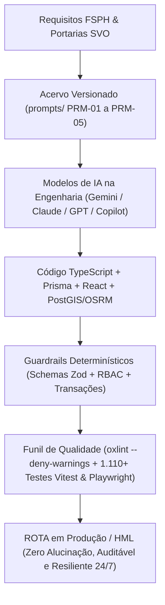

# Documentação de Integrações de IA, Engenharia de Prompt e Viabilidade Econômica

> **Fundação de Saúde Parreiras Horta (FSPH) · Squad 19 — ROTA**  
> **Entrega Final — Takeoff (Porto Digital & Unit)**  
> _Critérios atendidos: **1.2** (Documentação de Integrações de IA e Engenharia de Prompt), **1.4** (Rastreabilidade), **2.2** (Análise de Custo e Viabilidade Econômica) e **2.3** (Limites, Qualidade e Aprendizados)._

---

## 1. Contexto de Uso de IA e Arquitetura Híbrida do Squad 19 (Critério 1.2)

O sistema **ROTA** centraliza a gestão da frota administrativa (transporte de servidores, insumos laboratoriais do LACEN e hemoderivados do HEMOSE) e a logística crítica do **Serviço de Verificação de Óbito (SVO)** da FSPH em Sergipe.

Por tratar-se de uma operação de **saúde pública 24/7** regida por normas sanitárias (ANVISA), código de trânsito (CTB) e proteção de dados sensíveis (LGPD), o Squad 19 adotou uma **Arquitetura de Engenharia Assistida por IA com Runtime 100% Determinístico**:

### 1.1 Modelos e Ferramentas de IA Utilizados no Ciclo de Engenharia

| Ferramenta / Modelo | Papel no Desenvolvimento do Projeto ROTA | Impacto Técnico Mensurável |
| :--- | :--- | :--- |
| **Google Gemini / Antigravity** | Arquitetura full-stack, modelagem Prisma/PostGIS, trilha de auditoria LGPD, fluxos de cancelamento e suítes Vitest. | Aceleração da entrega de módulos complexos com 100% de cobertura nos novos serviços. |
| **Anthropic Claude & OpenAI GPT / Codex** | Refinamento de regras de concorrência, revisão de PRs, geração de massa sintética (`seed-demo.ts`) e PWA do motorista. | Identificação preventiva de condições de corrida (*race conditions*) em alocações e reservas. |
| **GitHub Copilot** | Autocompletar contextual em TypeScript, componentes React/Tailwind e tipagens de contratos de API. | Padronização de código e redução de boilerplate entre os 10 integrantes da squad. |

---

## 2. Engenharia de Prompt que Sustenta o Core da Aplicação (Critérios 1.2 e 1.4)

Todos os prompts estruturantes do sistema estão versionados e rastreados por histórico de commits na pasta [`../prompts/`](../prompts/README.md):

1. **[`PRM-01` — Arquitetura em Camadas e Modelagem Prisma (`v1.0` → `v3.0`)](../prompts/01-arquitetura-e-modelagem.md)**
   - Define o padrão `Controller -> Service -> Prisma`, validação estrita com `Zod (.strict())`, tratamento padronizado via `HttpError` e bloqueios de concorrência otimista (`versao` / transações atômicas).
2. **[`PRM-02` — Regras Sanitárias do SVO, Capacidade e SLA (`v1.0` → `v4.0`)](../prompts/02-regras-negocio-e-svo.md)**
   - Formaliza a elegibilidade SVO vs. IML (óbito natural vs. morte violenta), limite físico de `capacidadeMaxima` (4 urnas) nas viaturas SVO, ciclo obrigatório de `DESINFECCAO`, remanejamento operacional e cálculo de SLA sem fabricação de dados legados.
3. **[`PRM-03` — Qualidade, Testes, Sessão HttpOnly, CSRF e Regressão E2E (`v1.2` → `v3.5`)](../prompts/03-qualidade-testes-e-seguranca.md)**
   - Sustenta a suíte de **mais de 1.110 testes automatizados** (BackEnd Vitest + FrontEnd Testing Library + Playwright E2E), política de zero warnings no `oxlint --deny-warnings`, cookies `HttpOnly` (`SameSite=Lax`), proteção CSRF e rate limiting com hash SHA-256.
4. **[`PRM-04` — Massa Sintética Determinística e Auditoria LGPD (`v1.1` → `v3.0`)](../prompts/04-massa-dados-sinteticos-lgpd.md)**
   - Garante dados de demonstração 100% fictícios e idempotentes (`seed-demo.ts`) e sanitização recursiva (`sanitizarLgpd`) na Trilha de Auditoria administrativa (`GET /api/v1/auditoria`).
5. **[`PRM-05` — PWA do Motorista Offline-First, OSRM/PostGIS e Governança (`v1.0` → `v2.0`)](../prompts/05-pwa-motorista-osrm-e-governanca.md)**
   - Especifica o diário de bordo mobile com sincronização offline via IndexedDB (`idb`), cálculo de rota OSRM, telemetria PostGIS, gestão de avarias do checklist e relatórios oficiais CSV/PDF (`pdf-lib`).

---

## 3. Análise de Custo e Viabilidade Econômica (Critério 2.2)

O Squad 19 realizou o estudo comparativo de custos em duas dimensões: **(A) Custo real no desenvolvimento assistido por IA** e **(B) Estimativa matemática de custo por chamada/token caso um módulo consultivo de IA (LLM) opere em produção na FSPH**.

### 3.1 Estudo de Custo por Chamada e Token em Produção (Módulo Consultivo de Triagem SVO)

Cenário avaliado para a FSPH: assistente consultivo para apoiar o atendente na pré-análise textual do relato de ocorrência e na sumarização de relatórios mensais da frota.

- **Modelo de referência para escala pública:** `Gemini 2.5 Flash` / `GPT-4o-mini` (referência média: **US\$ 0,10 / 1M tokens de entrada** e **US\$ 0,40 / 1M tokens de saída**).
- **Volumetria operacional estimada na FSPH:**
  - ~30 chamados SVO/dia $\rightarrow$ **900 chamados/mês**.
  - ~70 solicitações administrativas e análises de avaria/dia $\rightarrow$ **2.100 operações/mês**.
  - **Total:** **3.000 chamadas/mês** (~100 chamadas/dia).
- **Consumo médio por chamada:** `500 tokens de entrada` (system prompt + relato/dados) e `200 tokens de saída` (JSON estruturado).

| Métrica | Fórmula / Cálculo Mensal | Volume Mensal | Custo Mensal (USD) | Custo Mensal Estimado (BRL)* |
| :--- | :--- | :---: | :---: | :---: |
| **Tokens de Entrada (Input)** | $3.000 \times 500\text{ tokens}$ | $1.500.000\text{ tokens}$ | $\text{US\$ } 0,15$ | $\text{R\$ } 0,87$ |
| **Tokens de Saída (Output)** | $3.000 \times 200\text{ tokens}$ | $600.000\text{ tokens}$ | $\text{US\$ } 0,24$ | $\text{R\$ } 1,39$ |
| **Custo por Chamada Individual** | $(500 \times 0,10 + 200 \times 0,40) / 10^6$ | $700\text{ tokens/req}$ | $\text{US\$ } 0,00013$ | $\text{R\$ } 0,00075$ |
| **Total Mensal (FSPH Inteira)** | $\text{Input} + \text{Output}$ | **$2,1\text{ milhões de tokens}$** | **$\text{US\$ } 0,39 / \text{mês}$** | **$\approx \text{R\$ } 2,26 / \text{mês}$** |

*\*Cotação de referência: $\text{US\$ } 1,00 = \text{R\$ } 5,80$.*

### 3.2 Trade-offs de Custo x Qualidade e Viabilidade em Escala Pública

1. **Zero Custo Recorrente de Tokens no Core Determinístico Atual:**
   - Como as regras de alocação, conflito de agenda, cálculo de rota (via container OSRM próprio + PostGIS) e triagem sanitária foram compiladas em código TypeScript determinístico durante a engenharia, o **custo variável de API de IA em tempo de execução para a FSPH hoje é R\$ 0,00/mês**.
2. **Previsibilidade Orçamentária para Órgão Público:**
   - Em órgãos públicos estaduais, contratações variáveis em dólar por token exigem processos licitatórios complexos e tetos rígidos (rate limiting de cota). Nossa arquitetura garante operação plena sem dependência de faturamento externo por requisição.
3. **Viabilidade em Caso de Expansão Consultiva:**
   - Caso a FSPH opte futuramente por habilitar um copiloto consultivo de relatórios/triagem, o custo de **~R\$ 2,26/mês** para 3.000 chamadas (ou menos de **R\$ 30,00/ano**) comprova viabilidade econômica absoluta mesmo se o volume estadual crescer 10x.

---

## 4. Limites, Garantia de Qualidade e Aprendizados (Critério 2.3)

### 4.1 "E se a IA falhasse?" — Resiliência Operacional

- **Na Operação da FSPH:** Como o runtime do ROTA não depende de disponibilidade de provedores externos de LLM (OpenAI/Google/Anthropic) para aprovar uma viagem ou despachar uma viatura do SVO, **uma queda global em APIs de IA tem impacto zero na operação hospitalar e de remoção de óbitos**. Para falhas de rede móvel em campo, o PWA do motorista conta com persistência offline via **IndexedDB** (`FrontEnd/src/features/motorista/offline.ts`).
- **No Desenvolvimento:** Quando um modelo de IA gerou código com falhas de regra de negócio, race conditions ou violações de lint (documentadas em [`PROMPTS_QUE_FALHARAM.md`](PROMPTS_QUE_FALHARAM.md)), o pipeline automatizado barrou a integração antes do merge na `master`.

### 4.2 O que a Equipe Deixou de Delegar à IA por Não Ser Confiável o Suficiente

1. **Decisão Autônoma SVO vs. IML:** Uma alucinação classificando um óbito com suspeita de violência como "morte natural" geraria crime de obstrução pericial e grave violação legal. A decisão final na triagem é obrigatoriamente **humana (`ATENDENTE SVO` e `GESTOR`)**, apoiada por validações determinísticas.
2. **Despacho de Viaturas sem Desinfecção ou Acima da Capacidade:** Nunca permitimos heurísticas flexíveis de IA para "otimizar rota" ignorando o status `DESINFECCAO` ou o limite de 4 urnas da viatura.
3. **Autorização de Acesso (RBAC) e Criptografia:** Verificações de permissão, revogação de sessão (`auth_sessoes`), validação de token CSRF e mascaramento LGPD são executados por algoritmos determinísticos auditáveis.
4. **Exposição de Dados Reais à IA:** Nenhum dado real de cidadãos, servidores ou falecidos da FSPH foi enviado a prompts de LLMs externos.

### 4.3 Processo de Garantia de Qualidade dos Outputs de IA

Todo artefato gerado com apoio de IA passou por **4 barreiras obrigatórias** antes de entrar na `master`:

1. **Checagem Estrita de Tipos (`tsc -p tsconfig.test.json`)**: Zero uso de `any` ou `@ts-ignore`.
2. **Linter com Tolerância Zero (`oxlint --deny-warnings`)**: Qualquer warning em `BackEnd` ou `FrontEnd` reprova imediatamente o CI.
3. **Suíte Automatizada (Vitest + Testing Library + Playwright)**: Mais de **1.110 testes automatizados** validando regras unitárias, contratos HTTP, componentes React e regressão E2E em contêineres ([`MATRIZ_QA_EXPLORATORIA.md`](MATRIZ_QA_EXPLORATORIA.md)).
4. **Revisão Humana por Pares em Pull Requests**: Inspeção manual de segurança, aderência ao domínio da FSPH e testes exploratórios documentados em [`RELATORIO_QA_REGRESSAO_2026-11-17.md`](RELATORIO_QA_REGRESSAO_2026-11-17.md).
