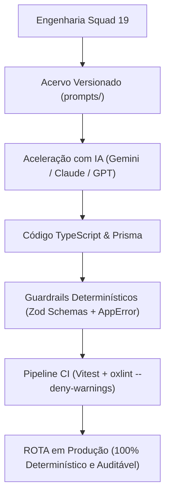

# Documentação de Engenharia de Prompt e Governança de IA

> **Fundação de Saúde Parreiras Horta (FSPH) · Squad 19 — ROTA**  
> **Entrega Final — Takeoff (Porto Digital & Unit)**  
> _Critérios atendidos: 1.2 (Documentação e Engenharia de Prompt), 1.4 (Rastreabilidade), 2.2 (Viabilidade Econômica) e 2.3 (Limites e Qualidade)._

---

## 1. Visão Geral e Filosofia de IA do Squad 19

O sistema **ROTA** gerencia a frota veicular institucional e a logística operacional do **Serviço de Verificação de Óbito (SVO)** da FSPH. Por se tratar de um ambiente crítico de **saúde pública**, onde decisões envolvem biossegurança, remoção de corpos, transporte de hemoderivados e respeito à LGPD de falecidos e servidores, a equipe adotou uma **Arquitetura Híbrida e Segura**:

### Princípio Fundamental: "O que NÃO delegamos à IA" (Critério 2.3)

1. **Decisões Sanitárias e Triagem Legal**: A equipe deliberadamente **não permitiu** que nenhuma IA decida monocraticamente se um óbito é do SVO ou do IML, nem autorize o despacho de viaturas em `DESINFECCAO`. Todas as regras de biossegurança são **determinísticas no código TypeScript** e com supervisão humana (_Human-in-the-Loop_).
2. **Privacidade de Dados (LGPD)**: Nenhum prontuário real, CPF real ou histórico clínico de cidadãos sergipanos foi enviado para APIs de IA comerciais. A IA foi empregada na **geração de dados sintéticos plausíveis** (`seed-demo.ts`) baseados em faixas reservadas de teste.
3. **Segurança de Acesso (RBAC)**: Autorizações de perfil (`ADMIN`, `GESTOR`, `SOLICITANTE`, `MOTORISTA`) são validadas por middlewares criptográficos JWT no Express, imunes a qualquer alucinação estatística.

---

## 2. Acervo e Rastreabilidade de Prompts (Critério 1.4)

Os prompts foram organizados por domínio e versionados diretamente no repositório GitHub para auditoria:

| Domínio                     | Arquivo de Prompts                                                                            | Versão | Foco Principal                                                              |
| :-------------------------- | :-------------------------------------------------------------------------------------------- | :----: | :-------------------------------------------------------------------------- |
| **Arquitetura & Modelagem** | [`prompts/01-arquitetura-e-modelagem.md`](../prompts/01-arquitetura-e-modelagem.md)           | `v2.1` | Separação Controller-Service, Prisma schemas, índices e DTOs.               |
| **Regras de Negócio & SVO** | [`prompts/02-regras-negocio-e-svo.md`](../prompts/02-regras-negocio-e-svo.md)                 | `v3.0` | Protocolos sanitários SVO, limite de 4 urnas na S10, status de desinfecção. |
| **Qualidade & Testes**      | [`prompts/03-qualidade-testes-e-seguranca.md`](../prompts/03-qualidade-testes-e-seguranca.md) | `v2.2` | Testes Vitest, mocks tipados do Prisma, zero warnings no `oxlint`.          |
| **Massa Sintética & LGPD**  | [`prompts/04-massa-dados-sinteticos-lgpd.md`](../prompts/04-massa-dados-sinteticos-lgpd.md)   | `v2.0` | Massa sintética da Rede Hospitalar de Sergipe sem dados pessoais reais.     |

Consulte o relatório enxuto [`docs/PROMPTS_QUE_FALHARAM.md`](./PROMPTS_QUE_FALHARAM.md) para análise de causa raiz de 2 prompts que falharam durante a construção do software.

---

## 3. Análise de Custo e Viabilidade Econômica (Critério 2.2)

Durante o planejamento, o Squad 19 avaliou o impacto financeiro de manter serviços de IA em produção versus utilizar regras determinísticas.

### Estudo de Caso: "Se a FSPH utilizasse um módulo de Apoio Consultivo de Triagem com LLM"

- **Modelo de Referência**: `Gemini 2.5 Flash` (custo: ~\$0,075 por milhão de tokens de entrada e ~\$0,30 por milhão de tokens de saída).
- **Volumetria Real FSPH**: ~30 acionamentos do SVO/dia (~900 chamados/mês).
- **Tamanho Médio por Chamada**: 400 tokens de contexto/relato + 150 tokens de resposta estruturada JSON.

| Métrica                       | Cálculo Matemático                       | Custo Estimado Mensal                      |
| :---------------------------- | :--------------------------------------- | :----------------------------------------- |
| **Tokens de Entrada**         | $900 \times 400 = 360.000\text{ tokens}$ | $\approx \$0,027\text{ USD}$               |
| **Tokens de Saída**           | $900 \times 150 = 135.000\text{ tokens}$ | $\approx \$0,040\text{ USD}$               |
| **Custo Total de Inferência** | $360k_{\text{in}} + 135k_{\text{out}}$   | **R\$ 0,38 / mês (menos de R\$ 1,00/mês)** |

### Conclusão de Viabilidade:

Mesmo com um custo de API quase nulo (R\$ 0,38/mês), a equipe optou por **priorizar a confiabilidade determinística de regras locais** no core operacional da residência, garantindo que a central de regulação do SVO funcione **24 horas por dia, 7 dias por semana, mesmo em casos de oscilação de internet ou indisponibilidade de APIs de terceiros** (_"E se a IA falhasse?"_).

---

## 4. Garantia de Qualidade dos Outputs de Código

Para garantir que o código gerado por IA atingisse nível profissional sem bugs ocultos:

1. **Linter Estrito no CI**: Configuração do `oxlint --deny-warnings` em ambos os workspaces (`BackEnd` e `FrontEnd`). Se a IA introduzir um `useEffect` com dependência inconsistente ou variável morta, o commit é bloqueado.
2. **Suíte Automatizada de Testes**: Mais de 500 testes automatizados cobrindo rotas, controllers, services, middlewares e componentes de tela.
3. **Code Review Obrigatório entre Pares**: Nenhuma linha entra na `master` sem Pull Request revisado por pelo menos outro membro do squad (como comprovado no PR #60).
